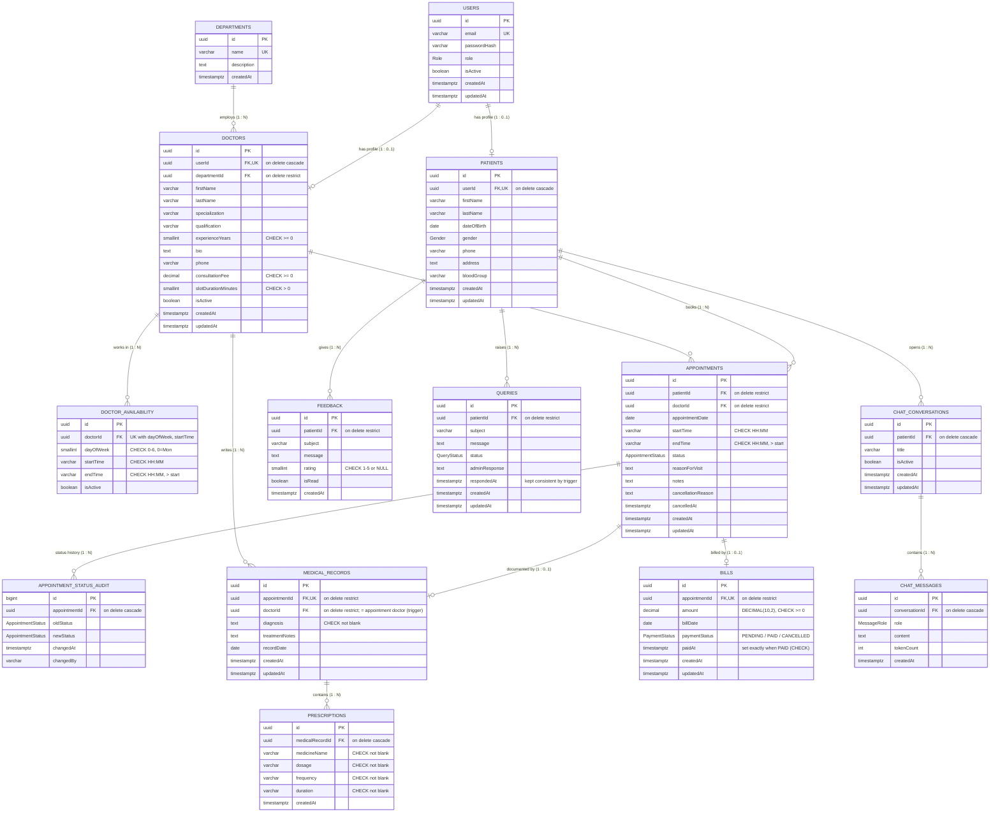

# ER diagram — final schema (Review 3)

This diagram matches `backend/prisma/schema.prisma` and the five migrations. GitHub renders the Mermaid source below directly. To edit it, paste the block into <https://mermaid.live> or any Mermaid/draw.io-compatible tool and export PNG/SVG for the report.

The Review 1 diagram (`er.jpeg`, kept outside the repository) shows ten entities. Review 3 added `APPOINTMENT_STATUS_AUDIT` (written only by the status-audit trigger, see `triggers.md`). The final review adds the three remaining ER-diagram entities — `MEDICAL_RECORDS`, `PRESCRIPTIONS` and `BILLS` — in migration `20261025100000_medical_records_bills_prescriptions`.

The eight core ER entities map to these tables: DEPARTMENT → `departments`, DOCTOR → `doctors`, DOCTOR_AVAILABILITY → `doctor_availability`, PATIENT → `patients`, APPOINTMENT → `appointments`, MEDICAL_RECORD → `medical_records`, BILL → `bills`, PRESCRIPTION → `prescriptions`. `users` holds login data for patients, doctors and admins.

## Cardinalities and delete rules

| Parent → child | Cardinality | FK | ON DELETE |
|---|---|---|---|
| users → patients | 1 : 0..1 | `patients.userId` (unique) | CASCADE |
| users → doctors | 1 : 0..1 | `doctors.userId` (unique) | CASCADE |
| departments → doctors | 1 : N | `doctors.departmentId` | RESTRICT |
| doctors → doctor_availability | 1 : N | `doctor_availability.doctorId` | CASCADE |
| patients → appointments | 1 : N | `appointments.patientId` | RESTRICT |
| doctors → appointments | 1 : N | `appointments.doctorId` | RESTRICT |
| appointments → appointment_status_audit | 1 : N | `appointment_status_audit.appointmentId` | CASCADE |
| appointments → medical_records | 1 : 0..1 | `medical_records.appointmentId` (unique) | RESTRICT |
| appointments → bills | 1 : 0..1 | `bills.appointmentId` (unique) | RESTRICT |
| doctors → medical_records | 1 : N | `medical_records.doctorId` | RESTRICT |
| medical_records → prescriptions | 1 : N | `prescriptions.medicalRecordId` | CASCADE |
| patients → feedback | 1 : N | `feedback.patientId` | RESTRICT |
| patients → queries | 1 : N | `queries.patientId` | RESTRICT |
| patients → chat_conversations | 1 : N | `chat_conversations.patientId` | CASCADE |
| chat_conversations → chat_messages | 1 : N | `chat_messages.conversationId` | CASCADE |

All foreign keys are `ON UPDATE CASCADE`.

## Constraints and indexes not visible in the diagram
- **Partial unique index** `appointments_active_doctor_slot_unique` on `(doctorId, appointmentDate, startTime)`, applied only when `status` is not a cancelled status. It blocks double-booking of active slots and lets cancelled slots be rebooked.
- **Appointment indexes:** `(patientId, appointmentDate, startTime)`, `doctorId`, `appointmentDate`, `(doctorId, appointmentDate)`. Elsewhere: `feedback.patientId`, `queries.patientId`, `chat_conversations.patientId`, `chat_messages(conversationId, createdAt)`, and `appointment_status_audit(appointmentId, changedAt)`.
- **6 enum types:** `Role`, `Gender`, `AppointmentStatus`, `QueryStatus`, `MessageRole`, `PaymentStatus`.
- **Final-review additions:** unique `medical_records.appointmentId` and `bills.appointmentId` (0..1 per appointment); indexes `medical_records.doctorId`, `prescriptions.medicalRecordId`, `bills.paymentStatus`; CHECKs `medical_records_diagnosis_not_blank_chk`, `prescriptions_fields_not_blank_chk`, `bills_amount_nonnegative_chk`, `bills_paid_at_consistent_chk`; trigger `trg_medical_records_doctor_match` (record doctor must be the appointment's doctor). Tests: `docs/dbms/tests/medical_billing_tests.sql` (16 cases).
